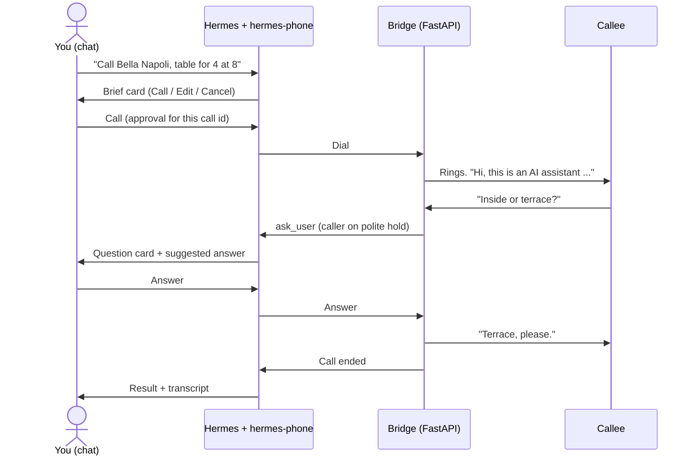

# hermes-phone

[](https://github.com/winchxyz/hermes-phone/actions/workflows/ci.yml)

**hermes-phone lets your Hermes agent make the phone calls you keep putting off.** Say "book a table" or "ask the clinic if they have a slot Friday", check the brief, tap Call. The agent introduces itself as an AI, handles the conversation, and when the other side asks something it doesn't know, it puts them on a polite hold and asks you in chat, with a suggested answer ready. You get the result, the confirmation number and the transcript. No call without your approval, no surprise sharing of card or address, no auto-redials, emergency numbers blocked.

Twilio Media Streams + OpenAI Realtime, native Hermes hooks, slash commands and live messages. Works from Telegram, Discord, Slack or the CLI.

Demo video: DEMO_VIDEO_URL

## How it works

1. **Ask.** "Call Bella Napoli and book a table for 4 tonight at 8." The agent finds or takes the number and calls `phone_prepare`, which only creates a brief card (who, number, goal, exact opening line, what will and won't be shared, limits).
2. **Approve.** You tap **Call** (`/phone approve <id>`). Nothing is dialed before that.
3. **Call.** The agent's first sentence is "Hi, this is an AI assistant calling on behalf of ...". If the other side asks something the brief doesn't cover, the agent says "One moment please, let me check", and a question card with a suggested answer lands in your chat. You answer, it continues. No answer within about 75 s: it says it will call back and the result is `needs_followup`.
4. **Result.** One result message (outcome, what was agreed, confirmation number, next steps, duration, estimated cost) and `/phone transcript <id>` for the full text.



Text version: you ask, the agent prepares a card, you approve, the bridge dials and the agent discloses it is an AI, a mid-call question goes to your chat with a suggestion while the callee waits, your answer is spoken, and when the call ends you get one result message and the transcript.

## Safety model

- **Approval per call id, enforced in three places.** `phone_prepare` never dials. `/phone approve <id>` records a one-use approval (15 min TTL, bound to that call id). The `pre_tool_call` hook blocks `phone_call` without it, the handler re-checks, and the bridge refuses to connect any call without a consumed approval.
- **AI disclosure is the first sentence of every call**, and the agent always answers yes to "am I talking to a robot?".
- **Emergency and premium blocklist, not configurable.** 911, 112, 999, 000, 110, 119, 100-103, 1-900, 1-976 and anything under 6 national digits are refused at prepare and at dial.
- **Dev allowlist, fail-closed.** Only numbers in `HERMES_PHONE_TEST_ALLOWLIST` can be dialed; unset or empty means all dialing is refused. The model cannot change it.
- **Sensitive-field consent.** Card, address, ID, bank, email and phone values are withheld from the voice model unless you grant that field for that call. CVV, passwords and OTP codes are never shared, with or without consent.
- **Rate limits.** 1 active call, a daily limit (default 10), 60 s between calls to the same number, hard duration cap of 900 s (default 300).
- **Quiet hours.** Calls outside 08:00 to 21:00 callee local time are refused unless you explicitly override.
- **No auto-redial.** No answer, busy or voicemail are reported plainly; `/phone retry <id>` creates a new call that needs a fresh approval.
- **Kill switch.** `/phone hangup` ends the live call within about a second.
- **Secrets only from environment variables.** Never logged, never in the image, never in tool output.

## Two modes

| | Twilio mode | Web phone mode |
|---|---|---|
| Callee | A real phone number (PSTN) | A page in your browser |
| Needs | Twilio account and number, OpenAI key, public URL | OpenAI key, public URL |
| Cost | Twilio minutes + Realtime | Realtime only |
| Best for | Real calls | Trying the whole flow in minutes |

**Twilio.** Real calls. Two lessons from live testing: a Twilio **trial** account cannot run custom call instructions (calls play a trial message instead), and an **upgraded** account needs an approved Trust Hub customer profile (KYC) before you can place calls from your number. Plan for that before demo day.

**Web phone.** No telephony account at all. The agent "rings" by posting a link in your chat; you open it, tap **Answer**, allow the mic, and play the callee. The full pipeline is the same (approval, disclosure, allowlist, quiet hours, mid-call questions, transcript). Use headphones; the link works once; an unanswered link ends as `no_answer` with no redial. Mode is picked by `HERMES_PHONE_MODE` (`web` or `twilio`), or automatically: Twilio when fully configured, else web.

## Quick start

### Railway (one container, official Hermes image)

The `Dockerfile` builds `nousresearch/hermes-agent` plus this plugin and runs the Hermes gateway (Telegram) and the bridge in one container, sharing one SQLite file.

1. Deploy this repo on Railway. Add a **Volume** mounted at `/opt/data`.
2. Set `PORT=8765`. Generate a domain and point it at target port **8765**. Never expose 8642: that is the Hermes API server.
3. Set `PUBLIC_BASE_URL=https://<your domain>` (no trailing slash) and the variables below, then redeploy. `https://<domain>/healthz` should return `{"ok":true}`.
4. In your Telegram chat send `/phone check`. It prints the mode and which variables are set (names only, never values).

| Variable | Needed | Purpose |
|---|---|---|
| `OPENAI_API_KEY` | yes | OpenAI Realtime voice |
| `PUBLIC_BASE_URL` | yes | Public https URL of the domain |
| `HERMES_PHONE_TEST_ALLOWLIST` | yes | Comma-separated E.164 numbers that may be dialed; empty refuses all |
| `TELEGRAM_BOT_TOKEN`, `TELEGRAM_ALLOWED_USERS` | yes | Bot token and numeric Telegram user ids (unset denies everyone) |
| `TWILIO_ACCOUNT_SID`, `TWILIO_AUTH_TOKEN`, `TWILIO_FROM_NUMBER` | Twilio mode | Credentials and caller id (E.164) |
| `HERMES_PHONE_MODE` | optional | `web` or `twilio` |
| `HERMES_PHONE_USER_NAME`, `HERMES_PHONE_CALLBACK_NUMBER` | recommended / optional | Who the agent calls for; callback number it may give |
| `HERMES_PHONE_QUESTION_TIMEOUT_S`, `_MAX_DURATION_S`, `_DAILY_CALL_LIMIT`, `_VOICE`, `_MODEL` | optional | Other plugin settings |

**The agent's brain (one of):**

- **OpenAI:** `HERMES_INFERENCE_PROVIDER=openai` and `HERMES_PHONE_LLM_MODEL=gpt-5-mini`. Simplest; reuses `OPENAI_API_KEY`. Set the provider explicitly, otherwise Hermes pairs your OpenAI key with the image's default non-OpenAI model and fails with HTTP 404.
- **Gemini:** `GEMINI_API_KEY` (Google AI Studio free tier). Used by default when no provider is set. The free tier is small and Hermes makes several requests per turn, so expect quota errors under heavy use.
- **OpenRouter:** `OPENROUTER_API_KEY`, `HERMES_INFERENCE_PROVIDER=openrouter`, `HERMES_PHONE_LLM_MODEL=<a :free model>`.

At boot `deploy/boot-config.py` merges these into Hermes' `config.yaml`. Blank variables never overwrite anything.

### Local / development

```bash
uv venv .venv && uv pip install -p .venv/bin/python -e '.[dev]'
.venv/bin/pytest -q -m "not e2e"
.venv/bin/ruff check .
```

To run the bridge yourself: `hermes phone serve` (or `python -m hermes_phone.bridge`, default `127.0.0.1:8765`), expose it with `cloudflared tunnel --url http://localhost:8765` or ngrok, and set `PUBLIC_BASE_URL` to that exact https URL (Twilio signatures are validated against it). `hermes phone doctor` checks env names, allowlist and bridge health. With Hermes installed: `hermes plugins validate . --install-deps` and `hermes plugins doctor . --ci`. The bridge must run in the same container as Hermes: both use the same SQLite database.

## Commands

| Command | What it does |
|---|---|
| `/phone approve <id>` | Approve the brief and place the call (Call / Edit / Cancel buttons; `/phone approve <id> confirm` where buttons are unavailable) |
| `/phone cancel <id>` | Cancel a prepared call |
| `/phone answer [<qid> [text]]` | List open questions, pick the suggestion, or answer a mid-call question (`decline` to refuse) |
| `/phone consent <id> <field>` | Allow one sensitive field for one call |
| `/phone status [<id>]` | State of a call |
| `/phone transcript <id>` | Full transcript |
| `/phone log [n]` | Recent calls |
| `/phone retry <id>` | New call from an unanswered one; needs fresh approval, once per brief |
| `/phone hangup [<id>]` | End the live call now |
| `/phone check` | Setup report: mode, allowlist, variables (names only) |

Agent tools: `phone_prepare`, `phone_call`, `phone_status`, `phone_transcript`. A bundled skill (`phone-calls`) teaches the agent the workflow.

## Costs (estimate)

Roughly 0.014 USD per minute for Twilio US outbound plus an assumed 0.15 USD per minute for OpenAI Realtime audio: a 1-minute call is about 0.2 USD. Web phone mode has no telephony cost, only Realtime. These are estimates, not bills; both rates are configurable (`twilio_cost_per_min_usd`, `realtime_cost_per_min_usd`) and the result message shows the estimate.

## Reliability

- **415 unit tests** (`pytest -m "not e2e"`, no network), ruff clean.
- **CI** on every push: unit tests on Python 3.11 and 3.12; the official `hermes plugins validate` and `hermes plugins doctor --ci` against a pinned hermes-agent commit; and a `docker build` with an import smoke test.
- **Exactly one result per call.** Every terminal state (success, partial, failed, needs_followup, no_answer, busy, voicemail, aborted, canceled, expired) produces one result message, enforced by a write-once result and a posted marker.
- **Restart safety.** State lives in SQLite. If Hermes restarts mid-call the bridge keeps the call and writes the result; the plugin posts any unposted result afterwards, once.
- Honest limits: unit tests use mocks for Twilio and OpenAI; real calls have been tested by hand, not in CI.

## Legal notes (not legal advice)

- **AI disclosure** opens every call. Some jurisdictions require it; it is the honest default anyway.
- **Recording consent.** Some places require all-party consent. Recording is off by default, opt-in per call, and announced on the call. Transcripts are text kept in plugin storage (disable with `store_transcripts: false`).
- **US TCPA / FCC.** The FCC treats AI-generated voices in calls as "artificial voice". This plugin only makes user-initiated, one-off calls to businesses you chose; it is not built for bulk, marketing or unsolicited calls, and the rate limits are there to keep it that way.
- No emergency numbers, no premium numbers, no auto-redial. You are responsible for how you use it.

## Capability disclosure

For catalog reviewers:

- Places **outbound PSTN calls through your own Twilio account** (costs money). Web mode places none.
- **Streams call audio to OpenAI Realtime** (third party) using your API key.
- Runs a **local FastAPI bridge** (webhooks and media WebSocket) exposed through `PUBLIC_BASE_URL`; Twilio requests are signature-validated, media sockets need a single-use token.
- Stores call logs and transcripts in **plugin data (SQLite)**.
- No telemetry, no self-update, no core patching, no reading of credential files. Secrets come only from environment variables.

## License

MIT. See [LICENSE](LICENSE).
