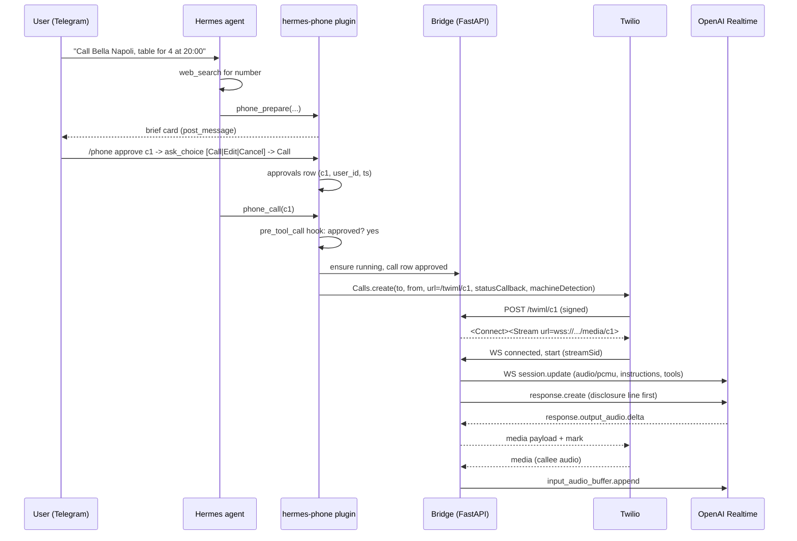
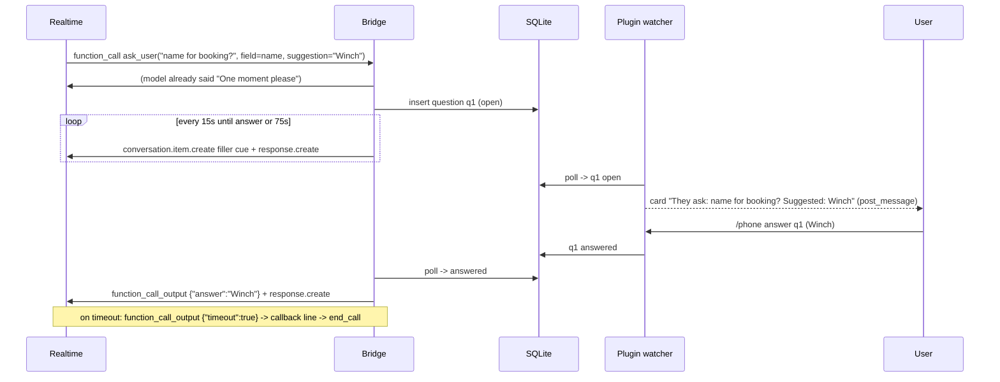
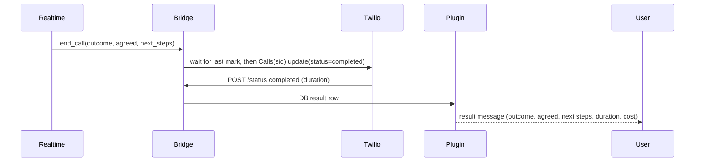

# hermes-phone ARCHITECTURE

## Components

1. **Hermes plugin (in-process)** root `__init__.py` (Hermes loads it by path as a package and calls `register(ctx)`; it re-exports `register` from the `hermes_phone/` package, which holds all logic and uses relative imports so it works both under Hermes and under pytest)
   - Tools: `phone_prepare`, `phone_call`, `phone_status`, `phone_transcript`.
   - Hook `pre_tool_call`: blocks `phone_call` without approval (`{"action": "block", "message": ...}`); `{"action": "approve"}` (escalate to Hermes' human-approval gate) and `{"action": "modify", "args": ...}` also exist (verified in HERMES_API.md) but are not used in P1.
   - Hook `pre_llm_call`: injects pending results and open questions as context so the agent reports them.
   - Slash command `/phone` with subcommands: `approve <id>`, `answer <id> <text>`, `status`, `transcript <id>`, `hangup`, `log [n]`, `retry <id>`. `/phone approve <id>` uses `ctx.ask_choice` to show Call / Edit / Cancel buttons (verified for sync slash-command handlers; it returns None when no asker is bound or the user cancels, so the fallback is `/phone approve <id> confirm`). Also `/phone consent <id> <field>` grants per-call consent.
   - CLI command `hermes phone serve|doctor|test-call` via `ctx.register_cli_command`.
   - Bundled skill `hermes-phone:phone-calls` (how and when to use the tools) via `ctx.register_skill`.
   - Store: `plugin_db("hermes-phone")` SQLite (WAL): tables `calls`, `approvals`, `consents`, `questions`, `events`, `transcripts`.
2. **Media bridge server (separate process)** `hermes_phone/bridge/`
   - FastAPI + uvicorn, started by `hermes phone serve` (or auto-spawned on first call). Listens on localhost; exposed via `PUBLIC_BASE_URL` (ngrok / cloudflared).
   - `POST /twiml/{call_id}` returns `<Response><Connect><Stream url="wss://.../media/{call_id}"><Parameter name="token" value="..."/></Stream></Connect></Response>` (query strings are not allowed in the Stream url, so the single-use token is a `<Parameter>` read from `start.customParameters`) (bidirectional stream).
   - `POST /status/{call_id}` Twilio status callbacks (initiated, ringing, answered, completed, busy, no-answer, failed) and AMD result.
   - `WS /media/{call_id}` Twilio Media Stream <-> OpenAI Realtime WebSocket. No transcoding: Twilio sends base64 mu-law 8 kHz; Realtime session uses `audio/pcmu` in and out.
   - Validates `X-Twilio-Signature` on every HTTP webhook; websocket URL carries a one-time token.
   - Shares the same SQLite DB with the plugin (path passed via env). This is the only IPC: plugin writes approved call rows, bridge writes events/questions/results, plugin reads them.
3. **Question relay**
   - Realtime session exposes function tool `ask_user(question, field, suggested_answer?)` and `end_call(outcome, agreed, next_steps)`.
   - Bridge writes a `questions` row and starts filler audio. The plugin's watcher thread (started inside `phone_call` with `contextvars.copy_context().run(...)` so it stays bound to the conversation) polls the DB every 500 ms and posts the card with `ctx.post_message`, then edits it when answered (verified API: Plugins user guide, "Posting a live message").
   - The user answers via `/phone answer <id> <text>` or by tapping a suggestion. For buttons, `/phone answer <id>` with no text calls `ctx.ask_choice([suggestion, "Other", "Don't share"])`.
   - Suggested answers: `ctx.dispatch_tool("memory", {...})` (tool name `memory` verified in HERMES_API.md) plus the user profile from plugin settings (`user_name`, `callback_number`).
4. **Voice backends** (interface `VoiceSession`)
   - Default: OpenAI Realtime over WebSocket, model `gpt-realtime-2.1` (configurable), `server_vad` or `semantic_vad`.
   - Alt: Gemini Live (needs mu-law 8 kHz -> PCM16 16 kHz in, PCM16 24 kHz -> mu-law 8 kHz out; `audioop` is removed in Python 3.13, use `numpy` + a small mu-law table).
   - Alt: Pipecat pipeline with `TwilioFrameSerializer` (STT + LLM + TTS). Good for open-source/local story; more latency. Keep behind the same interface, stretch only.

## Why this shape
- Plugin `register()` must not open sockets (doctor blocks network during registration), so the long-lived server is a separate process.
- `send_message` is not a model tool in Hermes by design; `ctx.post_message` is the sanctioned way to reach the conversation that invoked the plugin. That is exactly the conversation that should get questions.
- Approval is enforced in three places: brief state machine, `pre_tool_call` hook, and the bridge refuses `/twiml` for a call row not in `approved` state.

## Tool schemas

```json
{"name":"phone_prepare","description":"Prepare an outbound phone call and show the user an approval card. Never places a call. Use before phone_call.",
 "parameters":{"type":"object","properties":{
  "callee_name":{"type":"string"},
  "number":{"type":"string","description":"E.164, e.g. +14155550123"},
  "number_source":{"type":"string","description":"'user' or the URL where the number was found"},
  "goal":{"type":"string"},
  "facts_to_share":{"type":"object","description":"Key/value facts the agent may say, e.g. {\"name\":\"Winch\",\"party_size\":4}"},
  "sensitive_fields":{"type":"array","items":{"type":"string","enum":["card","address","id_number","bank","email","phone"]},"description":"Fields that need per-call consent"},
  "language":{"type":"string","default":"en"},
  "max_duration_s":{"type":"integer","default":300},
  "record":{"type":"boolean","default":false},
  "leave_voicemail":{"type":"boolean","default":false}},
  "required":["callee_name","number","goal"]}}
```
Returns `{"call_id","state":"awaiting_approval","brief":{...},"approve_hint":"/phone approve <id>"}` and posts the card.

```json
{"name":"phone_call","description":"Place a call that the user already approved. Fails if not approved.",
 "parameters":{"type":"object","properties":{"call_id":{"type":"string"}},"required":["call_id"]}}
```
Returns immediately `{"call_id","state":"dialing"}`; progress arrives as live messages.

```json
{"name":"phone_status","description":"Status of one call or the recent call log.",
 "parameters":{"type":"object","properties":{"call_id":{"type":"string"},"limit":{"type":"integer","default":10}}}}
```
```json
{"name":"phone_transcript","description":"Full transcript of a finished call. Only when the user asks.",
 "parameters":{"type":"object","properties":{"call_id":{"type":"string"}},"required":["call_id"]}}
```

Realtime function tools (inside the voice session, not Hermes tools): `ask_user(question, field, suggested_answer)`, `end_call(outcome, agreed:{date,time,name,party_size,price,confirmation_number,notes}, next_steps)`, `send_dtmf(digits)` (stretch).

## Sequence: approve and call



## Sequence: mid-call question



## Sequence: end and result



## Config (env)
`TWILIO_ACCOUNT_SID`, `TWILIO_AUTH_TOKEN`, `TWILIO_FROM_NUMBER`, `OPENAI_API_KEY`, `PUBLIC_BASE_URL`, optional `GEMINI_API_KEY`, `HERMES_PHONE_TEST_ALLOWLIST`, `HERMES_PHONE_BRIDGE_PORT` (default 8765). Plugin settings via `config_schema`: `user_name`, `callback_number`, `voice`, `model`, `question_timeout_s`, `max_duration_s`, `daily_call_limit`, `store_transcripts`, `default_record`, `twilio_cost_per_min_usd`, `realtime_cost_per_min_usd`.

Secrets read from env (os.environ, declared in requires_env). `PluginContext` has no secret accessor (verified); `agent.secret_scope.get_secret` exists but is core-internal, so the plugin uses os.environ, and passed to the bridge subprocess through its environment only.


## P2 as built

- Package `hermes_phone/bridge/`: `app.py` (routes, gating), `status.py` (Twilio status -> states),
  `session.py` (one call: pumps, barge-in, tools, ticker for max duration and end grace),
  `realtime.py` (connector, session.update, instructions), `twilio_io.py`, `settings.py`.
- Realtime and Twilio REST are injected into `create_app`; all time logic uses one clock.
- The bridge finalises state itself on end_call, max duration, Realtime loss and callee hangup
  before the Twilio `completed` callback arrives; the callback is then a harmless duplicate
  (state machine plus `Store.set_result_once` give exactly one result).
- The DB env for the standalone bridge is `HERMES_PHONE_DB_PATH` (alias of the store's
  `HERMES_PHONE_DB`).
- `TwilioDialer` lives in `hermes_phone/dialer.py`; `PhoneService.dialer` resolves lazily from env
  and `phone_call` calls `dialer.preflight()` (bridge `/healthz`) before spending the approval.


## P3 as built

- Bridge (`session.py`): `ask_user` is handled in its own task (`_await_answer`), so audio keeps
  flowing while the function call is pending. Questions go open -> answered | declined |
  timeout -> late. States: `in_progress -> on_hold_for_user -> in_progress`. After a timeout the
  bridge stores the result itself (`needs_followup`, reason `question_timeout`) and hangs up once
  the callback line's response finished (or after `closing_max_s`), instead of trusting the
  model to call `end_call`.
- Plugin (`relay.py`): `CallWatcher` (daemon thread via `contextvars.copy_context().run`)
  polls every 0.5 s; one editable status message plus one card per question; cards carry
  `card_posted` so `pre_llm_call` does not repeat them. The question card suggestion order is:
  consent-filtered brief facts, `user_name`, Hermes memory (best effort, see PROGRESS), the
  voice model's guess. Consent cards have no suggestion.
- The brief's `limits.question_timeout_s` carries the plugin setting to the separate bridge
  process; the DB is still the only IPC (`questions`, `calls.hangup_requested_at`).
- Kill switch: `/phone hangup` -> `calls.hangup_requested_at`; bridge ticker (<= tick_s)
  finishes `aborted/user_hangup`; plugin fallback after 2 s uses `TwilioDialer.hangup`.

## Web phone mode as built

`hermes_phone/mode.py` resolves the mode from env (`HERMES_PHONE_MODE=web|twilio`, else Twilio
when complete, else web when `OPENAI_API_KEY` and `PUBLIC_BASE_URL` are set). `PhoneService` then
picks `WebPhoneDialer` (a `TwilioDialer` subclass, so `preflight` is shared). Same gates before
dialing (validate, blocklist, allowlist, approval, quiet hours, rate limits); `place_call` only
mints a 10-minute single-use token (`web_tokens`, sha256 at rest, constant-time compare) and
returns `provider_sid = web-<call id>` plus the link. The plain token exists only in memory
(`svc.answer_links`) until the watcher posts `{PUBLIC_BASE_URL}/phone/{id}?t=...`.

Bridge (`bridge/webroutes.py`, page in `bridge/webpage.py`): `GET /phone/{id}?t=` validates
without consuming and serves one inline page (CSP with a per-response nonce, `no-store`,
`no-referrer`); `POST /phone/{id}/answer` consumes the token, moves dialing/ringing to
in_progress (same `_advance` as the Twilio status callback) and mints the media token from the
same table `/twiml` uses. All failures are one generic 404; a light in-memory rate limit applies.
The page then opens `WS /media/{id}` and speaks the Twilio Media Streams protocol (`connected`,
`start` with `customParameters.token`, 20 ms mu-law `media`, `mark` echoes, `stop`; handles
`media`, `mark`, `clear`), so `CallSession` is unchanged except: transcript lines are also
pushed to the page as `transcript` events, and for `web-` sids `_hangup_rest` sends `ended` and
closes the socket instead of calling Twilio. `/phone hangup` uses the existing DB flag
(`WebPhoneDialer.hangup` sets it). `webphone.expire_stale` (called by the watcher and by the web
routes) gives exactly one `no_answer` 60 s after the link was minted, and fails a call whose page
answered but never opened the media socket within 30 s.

## Results (P4)

`hermes_phone/results.py` builds every user-facing result string; nothing else formats outcomes.

- **One result per call.** The watcher posts a NEW message (not an edit, so Telegram notifies) when
  it sees a terminal state, then stores `calls.result_posted_at` (also sets `result_delivered`).
  A new watcher, a reload or a second `/phone` call finds it set and posts nothing. If posting
  fails 3 times the row stays unposted and `pre_llm_call` hands the formatted result to the agent
  once (it also skips calls whose watcher is still alive). That covers a Hermes restart mid-call.
- **Text.** Built from `end_call` fields (`agreed`, `next_steps`) and bookkeeping, scrubbed of
  card/email/ID/IBAN patterns, sensitive keys and the brief's own sensitive values even when
  consent was given. Plain text, a leading status emoji, no Markdown.
- **Duration and cost.** Duration: Twilio `CallDuration` (stored by the status callback) else the
  bridge stamp (web mode) else timestamps. Cost estimate = ceil(minutes) x `twilio_cost_per_min_usd`
  (default 0.014, US outbound; 0 in web mode) + minutes x `realtime_cost_per_min_usd` (default
  0.15, about $0.05 input plus $0.08 output audio per minute rounded up). It is an estimate,
  shown as "about $X.XX", never a bill.
- **Transcripts.** `transcripts` table, rendered "Agent:" / "Them:", split under 3500 chars per
  message; `store_transcripts: false` keeps only the summary.
- **Retry.** `/phone retry <id>` calls `phone_prepare` logic with the stored brief (plus late
  answers, consent-filtered) and sets `calls.retry_of`; the new call awaits its own approval.
  Max one retry per original brief.
- **Disclosure check.** The bridge looks at the first agent transcript line (even when transcripts
  are not stored) and sets `calls.disclosure_spoken`; `phone_status` reports it.

## Plain-text replies (safety reasoning)

`hermes_phone/reply.py`, called first thing in `pre_llm_call` (verified in HERMES_API.md,
"`pre_llm_call` block, verified end to end"). Besides `/phone answer` and `/phone approve`, the
user can reply in plain text in the chat that started the call:

- **Answers.** If that session (call `origin_session_id`, stored by `phone_prepare`) has exactly
  one open question on a live call, a non-slash message of at most 300 characters answers it. The
  turn is blocked (no model call) and the reply is `Sent to <callee>: "<answer>"`. A short
  affirmative sends the suggestion that was shown on the card (`questions.card_suggestion`), and
  does nothing if there was none. `no`/`decline`/`don't share` decline. A consent question is
  never answered by "yes": only `decline` works in plain text; sharing needs `/phone consent` or
  `/phone answer <qid> <value>`. Text that looks like a sensitive value is refused by the same
  consent check `/phone answer` uses. Two or more open questions fall back to `/phone answer <id>`.
- **Approvals.** If the session has exactly one `awaiting_approval` card that has not expired, a
  message that is exactly `call`, `yes`, `go`, `approve`, `да`, `звони` or `позвони` approves and
  dials it (`commands.approve_by_reply`); `cancel`, `no`, `нет`, `отмена` cancels it. The same
  re-checks as `/phone approve` run (number validity, allowlist), then `phone_call` runs its own
  (approval record, blocklist, quiet hours, rate limits, one active call).

Why this is still an explicit human approval: `pre_llm_call` receives the text the human typed
into that chat; the model cannot produce a user message, and the hook runs before any model call,
so the model is not involved in the decision. Approval stays bound to that exact call id, that
session, a timestamp and the 15 minute TTL, and works once. A different chat or session never
matches (`origin_session_id`), so one conversation cannot answer or approve for another. The
`pre_tool_call` veto and `check_approval` are unchanged: a model-issued `phone_call` is still
refused without the recorded approval. Anything not matching exactly falls through to the model
unchanged.

## Chat noise, buttons and the quiet agent (verified against Hermes source)

- **One reply per card.** `phone_prepare` tells the model to answer with only the pointer
  character, and the plugin enforces it: a `transform_llm_output` hook rewrites the final reply of
  the turn that posted a card to that pointer (`agent/turn_finalizer.py:542`, the first non-empty
  string returned by a hook wins; hook name listed at `hermes_cli/plugins.py:111`). Hermes has no
  per-tool "end the turn" flag, so the rewrite is the supported way.
- **Approve reply merged into the live status.** When the watcher's editable status message is
  out, `/phone approve` replies with an empty string (Hermes sends no reply for a falsy handler
  result, `gateway/run_inbound_hooks.py:301`). A plain "call" reply must give a non-empty block
  message (`agent/conversation_loop.py:1615`), so it gets a thumbs-up. Status then edits in place:
  dialing, ringing, connected, on hold, finished.
- **Question cards are retried.** A card whose post fails (the gateway may be busy or the session
  not bound yet) is retried about once a second for the whole question window instead of three
  times in 1.5 s, and a question that closed before any card made it out gets one closing message.
  Memory lookups for suggestions have a 1.5 s budget so they cannot delay a card.
- **No buttons for question cards (design decision).** `ctx.ask_choice` uses an asker bound by
  `bind_asker` only "around the handler call" of a slash command
  (`hermes_cli/plugin_choices.py:5-20`, `gateway/plugin_command_choice.py:chat_choices`). The
  watcher thread does inherit the ContextVar through `contextvars.copy_context`, but after the
  handler returned the asker is outside its documented lifetime, it blocks the watcher thread for
  the clarify timeout (stalling status and other cards), and a pending clarify intercepts the
  user's next typed message, which would fight the plain-text reply path. Plain "call" approvals
  run in a hook, where no asker is bound at all. So question answers stay plain replies.
- **Quiet agent.** Hermes' "offer to build a short profile" is the first-message directive in
  `agent/onboarding.py:178-189`, controlled by `onboarding.profile_build` (`"ask"` default,
  `"off"` stops it: `agent/onboarding.py:119-125`, docs `website/docs/user-guide/configuration.md`
  "Onboarding"). `deploy/boot-config.py` sets it to `off` when `HERMES_PHONE_QUIET_AGENT=1`
  (default in the Docker image; set it to `0` to keep the offer).
